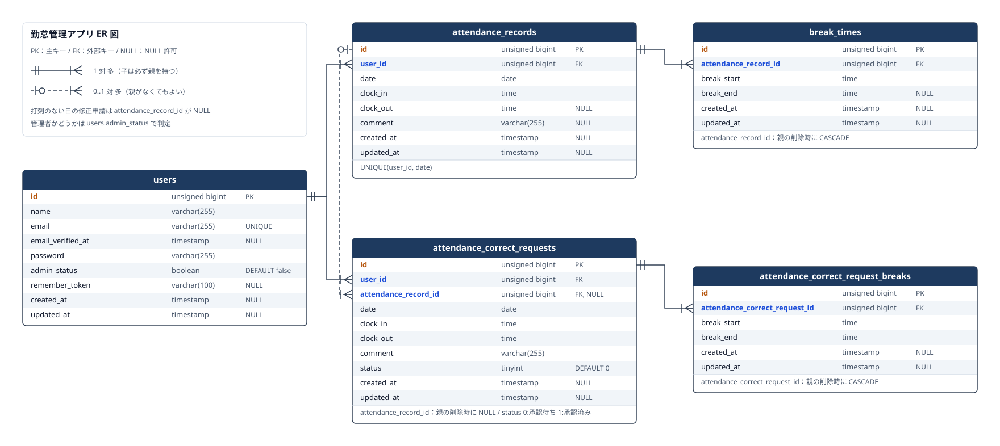

# 勤怠管理アプリ（COACHTECH模擬案件）

coachtech 模擬案件の勤怠管理アプリです。一般ユーザーは出勤・休憩・退勤の打刻と、勤怠の修正申請ができます。管理者は全ユーザーの勤怠の確認・直接修正と、修正申請の承認ができます。

## 環境構築

このリポジトリをクローンして動かす手順です。

### Docker ビルド

1. リポジトリをクローンする

    ```bash
    git clone https://github.com/tezuka0/attendance-app.git
    cd attendance-app
    ```

2. PHP のパッケージをインストールする（`vendor` がまだないため、Docker で直接実行する）

    ```bash
    docker run --rm \
        -u "$(id -u):$(id -g)" \
        -v "$(pwd):/var/www/html" \
        -w /var/www/html \
        laravelsail/php82-composer:latest \
        composer install --ignore-platform-reqs
    ```

3. 環境変数ファイルを作成する

    ```bash
    cp .env.example .env
    ```

    `.env.example` には、Sail 用の DB（`DB_HOST=mysql` / `DB_USERNAME=sail` / `DB_PASSWORD=password`）とメール（`MAIL_HOST=mailpit` / `MAIL_PORT=1025`）の設定が入っています。

4. コンテナを起動する

    ```bash
    ./vendor/bin/sail up -d
    ```

### Laravel 環境構築

1. アプリケーションキーを作成する

    ```bash
    ./vendor/bin/sail artisan key:generate
    ```

2. マイグレーションと初期データを登録する

    ```bash
    ./vendor/bin/sail artisan migrate --seed
    ```

3. フロントエンドをビルドする

    ```bash
    ./vendor/bin/sail npm install
    ./vendor/bin/sail npm run build
    ```

### 参考：プロジェクト作成時の手順

要件シートの環境構築手順に沿って、このプロジェクトを作成したときの手順です。**このリポジトリを動かすだけなら、上の手順で足りるため不要です。**

1. Laravel 10 のプロジェクトを新規作成する

    ```bash
    docker run --rm \
        -u "$(id -u):$(id -g)" \
        -v "$(pwd):/var/www/html" \
        -w /var/www/html \
        -e COMPOSER_CACHE_DIR=/tmp/composer_cache \
        laravelsail/php82-composer:latest \
        composer create-project laravel/laravel:^10.0 attendance-app
    cd attendance-app
    ```

2. Laravel Sail を導入する（mysql, mailpit）

    ```bash
    docker run --rm \
        -u "$(id -u):$(id -g)" \
        -v "$(pwd):/var/www/html" \
        -w /var/www/html \
        laravelsail/php82-composer:latest \
        php artisan sail:install --with=mysql,mailpit
    ```

3. compose.yaml の mysql サービスの後に、phpMyAdmin を追加する

    ```yaml
    phpmyadmin:
        image: "phpmyadmin:latest"
        ports:
            - "${FORWARD_PHPMYADMIN_PORT:-8080}:80"
        environment:
            PMA_HOST: mysql
            PMA_USER: "${DB_USERNAME}"
            PMA_PASSWORD: "${DB_PASSWORD}"
        networks:
            - sail
        depends_on:
            - mysql
    ```

4. `.env` の DB とメールの設定を、次の値にする

    ```dotenv
    DB_CONNECTION=mysql
    DB_HOST=mysql
    DB_PORT=3306
    DB_DATABASE=laravel
    DB_USERNAME=sail
    DB_PASSWORD=password

    MAIL_MAILER=smtp
    MAIL_HOST=mailpit
    MAIL_PORT=1025
    ```

5. 提供 Blade を移入する

    ```bash
    git clone -b basic https://github.com/coachtech-prepared-file/Preparedblade-mockcase-Attendance.git
    ```

    クローンした `resources/` を、プロジェクトの `resources/` に上書きコピーします。応用機能の着手時に、`advanced` ブランチの `resources/` を再移入します。

6. `vite.config.js` で、提供 CSS を個別に読み込むよう指定する

    ```js
    import { defineConfig } from "vite";
    import laravel from "laravel-vite-plugin";

    export default defineConfig({
        plugins: [
            laravel({
                input: [
                    "resources/js/app.js",
                    "resources/css/sanitize.css",
                    "resources/css/common.css",
                    "resources/css/auth/verify-email.css",
                    "resources/css/user/register.css",
                    "resources/css/user/user-login.css",
                    "resources/css/user/attendance-register.css",
                    "resources/css/user/user-attendance-list.css",
                    "resources/css/user/user-detail.css",
                    "resources/css/user/user-application-list.css",
                    "resources/css/admin/admin-login.css",
                    "resources/css/admin/admin-attendance-list.css",
                    "resources/css/admin/admin-detail.css",
                    "resources/css/admin/admin-application-list.css",
                    "resources/css/admin/admin-application-detail.css",
                    "resources/css/admin/staff-list.css",
                    "resources/css/admin/staff-attendance-list.css",
                    "resources/css/reports/index.css",
                ],
                refresh: true,
            }),
        ],
    });
    ```

7. 起動と初期化は、上の「Docker ビルド」の手順4と「Laravel 環境構築」と同じです。

指定技術スタック外のパッケージ（`laravel-lang/*` など）は追加していません。日本語のメッセージは、FormRequest に直接記述しています。

## 使用技術（実行環境）

- PHP 8.2
- Laravel 10
- MySQL 8.4
- Laravel Sail（Docker）
- Laravel Fortify（会員登録・ログイン・メール認証）
- Laravel Sanctum（API 認証）
- Mailpit（開発用メールサーバー）
- phpMyAdmin
- Vite

## ER 図



## URL

| 画面                        | URL                          |
| --------------------------- | ---------------------------- |
| 一般ユーザー ログイン       | http://localhost/login       |
| 管理者 ログイン             | http://localhost/admin/login |
| phpMyAdmin                  | http://localhost:8080/       |
| Mailpit（認証メールの確認） | http://localhost:8025/       |

## ログイン情報

`migrate --seed` で次のユーザーが作成されます。パスワードはすべて `password` です。

| ユーザー  | 名前     | メールアドレス    | 権限         |
| --------- | -------- | ----------------- | ------------ |
| ユーザー1 | 田中太郎 | user1@example.com | 一般ユーザー |
| ユーザー2 | 佐藤花子 | user2@example.com | 一般ユーザー |
| ユーザー3 | 管理者   | user3@example.com | 管理者       |

ユーザー1には、マイ勤怠レポートの検証用に固定の勤怠データ（過去5か月と今月）が入っています。ユーザー2・ユーザー3には、ランダムな勤怠データが入っています。

## テスト

```bash
./vendor/bin/sail artisan test
```

テストは `testing` データベースを使うため、開発用のデータは消えません。

## 応用機能

- **メール認証**：会員登録後に認証メールが届きます（Mailpit で確認できます）。
- **CSV 出力**：管理者のスタッフ別勤怠一覧から、1か月分の勤怠を CSV でダウンロードできます。
- **マイ勤怠レポート**（`/attendance/report`）：過去6か月の総労働時間・総残業時間・1日あたりの平均労働時間・月次推移と、今月の遅刻・早退・長時間労働の回数を表示します。
- **公開 API**（`/api/v1/attendance-records`）：勤怠の一覧と詳細は認証なしで取得できます。作成・更新・削除には Sanctum のトークンが必要です。

### API トークンの発行方法

トークンは tinker で発行します。

```bash
./vendor/bin/sail artisan tinker
```

```php
App\Models\User::where('email', 'user1@example.com')->first()->createToken('api')->plainTextToken;
```

表示されたトークンを、リクエストの `Authorization: Bearer {トークン}` ヘッダーに付けて送信します。

## 作成者

手塚誉幸
